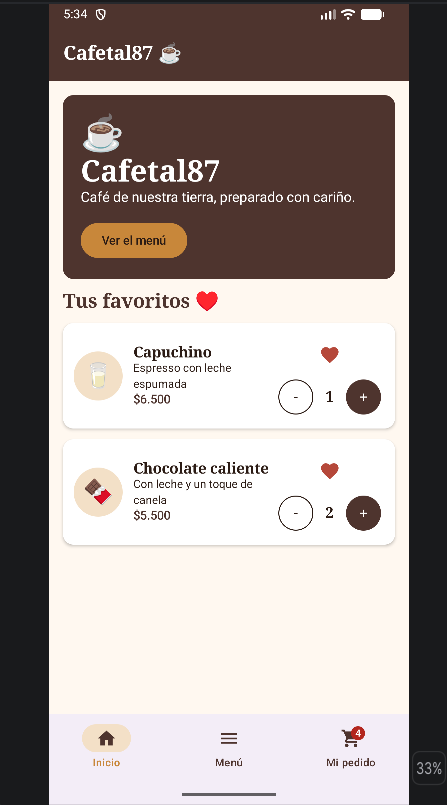
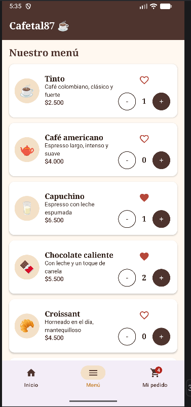
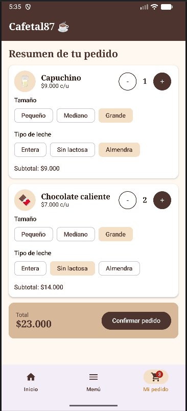

# Cafetal87 ☕

## Descripción del negocio
**Cafetal87** es una cafetería de café colombiano que ofrece bebidas calientes (tinto, americano, capuchino, chocolate) y comida ligera (croissant, pan de bono, tortas y sándwiches).

## Objetivo de la aplicación
Permitir que el cliente consulte el menú, marque sus productos favoritos, arme su pedido, personalice sus bebidas y vea el total a pagar antes de confirmar.

## Tecnologías
- Kotlin
- Jetpack Compose
- Material 3 (tema personalizado con `Color.kt`, `Theme.kt` y `Type.kt`)
- Navigation Compose

## Pantallas implementadas
1. **Inicio:** banner de bienvenida con la identidad de la cafetería y la lista de productos favoritos.
2. **Menú:** lista dinámica (LazyColumn) de productos generada desde una colección, con botones de cantidad y favorito.
3. **Mi pedido:** resumen de los productos seleccionados, personalización de bebidas, total y confirmación del pedido.

La navegación entre pantallas se hace con `NavController` y `NavHost`, y una barra de navegación inferior.

## Funcionalidades interactivas
1. **Aumentar y disminuir cantidades (trabajada en clase):** los botones `+` y `-` de cada producto cambian la cantidad, y las cantidades seleccionadas se muestran en la pantalla Mi pedido y en el contador de la barra inferior.
2. **Favoritos (nueva):** el corazón de cada producto lo marca o desmarca como favorito, y los favoritos se consultan en la pantalla Inicio.
3. **Personalizar bebida (nueva):** en Mi pedido, cada bebida permite elegir tamaño (pequeño, mediano, grande) y tipo de leche (entera, sin lactosa, almendra). El precio, el subtotal y el total se actualizan automáticamente.

## Capturas de pantalla

  
  
  

## Cómo ejecutar el proyecto
1. Clona el repositorio: `git clone <URL-DEL-REPOSITORIO>`
2. Abre la carpeta en Android Studio (**File > Open**).
3. Espera a que Gradle termine de sincronizar.
4. Selecciona un emulador (por ejemplo, Pixel 6) o un dispositivo Android.
5. Pulsa **Run** (▶).

## Autor
Juan Manuel Varon Duque- Universidad Tecnológica de Pereira - Asignatura Aplicativos Móviles