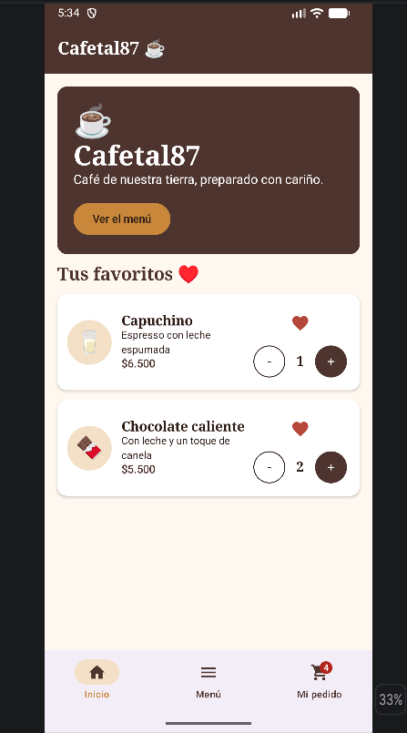
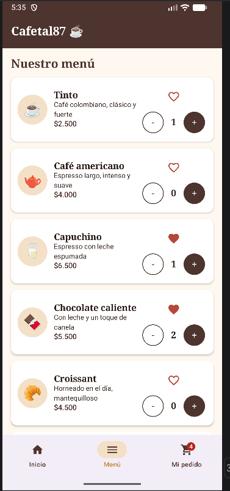
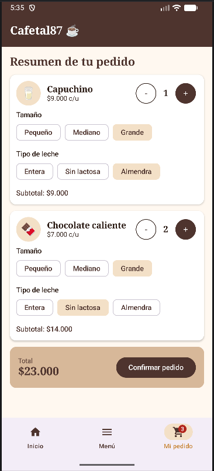

# Cafetal87 ☕

## Primer Corte
## Descripción del negocio
**Cafetal87** es una cafetería de café colombiano que ofrece bebidas calientes (tinto, americano, capuchino, chocolate) y comida ligera (croissant, pan de bono, tortas y sándwiches).

## Objetivo de la aplicación
Permitir que el cliente consulte el menú, marque sus productos favoritos, arme su pedido, personalice sus bebidas y vea el total a pagar antes de confirmar.

## Tecnologías
- Kotlin
- Jetpack Compose
- Material 3 (tema personalizado con `Color.kt`, `Theme.kt` y `Type.kt`)
- Navigation Compose

## Pantallas implementadas
1. **Inicio:** banner de bienvenida con la identidad de la cafetería y la lista de productos favoritos.
2. **Menú:** lista dinámica (LazyColumn) de productos generada desde una colección, con botones de cantidad y favorito.
3. **Mi pedido:** resumen de los productos seleccionados, personalización de bebidas, total y confirmación del pedido.

La navegación entre pantallas se hace con `NavController` y `NavHost`, y una barra de navegación inferior.

## Funcionalidades interactivas
1. **Aumentar y disminuir cantidades (trabajada en clase):** los botones `+` y `-` de cada producto cambian la cantidad, y las cantidades seleccionadas se muestran en la pantalla Mi pedido y en el contador de la barra inferior.
2. **Favoritos (nueva):** el corazón de cada producto lo marca o desmarca como favorito, y los favoritos se consultan en la pantalla Inicio.
3. **Personalizar bebida (nueva):** en Mi pedido, cada bebida permite elegir tamaño (pequeño, mediano, grande) y tipo de leche (entera, sin lactosa, almendra). El precio, el subtotal y el total se actualizan automáticamente.

## Capturas de pantalla

  
  
  

## Cómo ejecutar el proyecto
1. Clona el repositorio: `git clone <URL-DEL-REPOSITORIO>`
2. Abre la carpeta en Android Studio (**File > Open**).
3. Espera a que Gradle termine de sincronizar.
4. Selecciona un emulador (por ejemplo, Pixel 6) o un dispositivo Android.
5. Pulsa **Run** (▶).

## Segundo corte: MVVM, Room y roles

Cafetal87 evolucionó, ahora se actualizó con arquitectura MVVM y almacenamiento local con Room. Los datos se conservan al cerrar y volver a abrir la aplicación.

### Cuentas de prueba (ya registradas)
- **Empleado:** empleado@cafetal87.com / empleado123
- **Cliente:** cliente@cafetal87.com / cliente123
- Para registrar un nuevo empleado se pide el código: **CAFE87**

### Funcionalidades nuevas y cómo probarlas

1. **Registro de usuarios (cliente o empleado).** En el inicio de sesión pulsar "Regístrate", llenar nombre, correo, contraseña y confirmación, y elegir Cliente o Empleado (el empleado requiere el código CAFE87). Probar las validaciones: campos vacíos, correo inválido, contraseña corta, contraseñas distintas y correo repetido.
2. **Registro de productos (empleado).** Iniciar sesión como empleado > Productos > "Agregar producto" > llenar nombre, precio y categoría > "Registrar producto". Aparece en la lista y en el menú del cliente.
3. **Edición de productos (empleado).** Productos > "Editar" en un producto > cambiar el precio > "Guardar cambios". Verificar el nuevo precio en el menú del cliente.
4. **Eliminación y cambio de estado.** Como empleado: Productos > "Eliminar" (con confirmación) o el interruptor para marcar un producto como agotado. En Pedidos, cambiar el estado de un pedido (Pendiente, Preparando, Entregado).
5. **Consulta del historial de pedidos.** Como cliente: Menú > agregar productos (con + y -) > Mi pedido > elegir tamaño y leche > "Confirmar pedido" > "Mis pedidos". El empleado ve todos los pedidos en la pestaña Pedidos, con el total vendido y un filtro por estado.
6. **Búsqueda y filtro (complementaria).** En Menú, escribir en el buscador y elegir la categoría Bebidas o Comida.
7. **Favoritos por usuario guardados en Room.** Tocar el corazón de un producto; aparece en Inicio y se conserva al reiniciar. Cada usuario tiene sus propios favoritos: al cerrar sesión y entrar con otra cuenta, los favoritos son distintos.

### Prueba de persistencia
Registrar un producto o confirmar un pedido, cerrar la app por completo (quitarla de recientes), abrirla de nuevo e iniciar sesión: los datos siguen ahí.

### Arquitectura
- `data/local`: entidades (Usuario, Producto, Pedido, DetallePedido, Favorito), DAOs y base de datos Room.
- `data`: Repository.
- `viewmodel`: AuthViewModel, MenuViewModel, PedidoViewModel y AdminViewModel con StateFlow.
- `ui`: pantallas y componentes en Jetpack Compose, y `navigation` con Navigation Compose.

## Autor
Juan Manuel Varon Duque- Universidad Tecnológica de Pereira - Asignatura Aplicativos Móviles